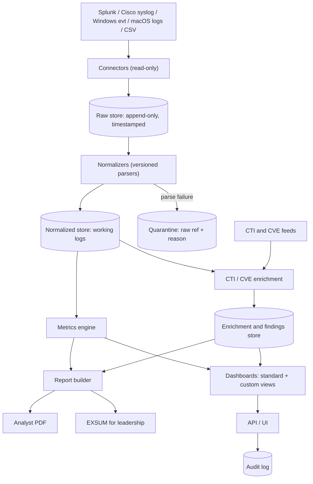

# Architecture

## What this repository provides

GammaRay is a SOC dashboard. It ingests log data from SIEM tools, syslog, host event logs, and CSV files; retains every record as immutable raw data; normalizes it into a common schema; and computes custom and standardized metrics over the normalized data. Analysts view and customize visualizations, export PDF reports for other analysts, and produce an executive summary (EXSUM) for leadership. The same normalized data feeds CTI and CVE analysis.

Initial sources: Splunk, Cisco syslog, Windows event logs, macOS event logs, CSV. Additional log types are added by writing a connector and a normalizer; no downstream component changes.

Application behavior belongs in `src/`; developer checks belong in `scripts/`; stable instructions belong in `docs/`. `AGENTS.md` routes agents to the relevant documents.

## Data flow

Flow is one-directional. Connectors write only to the raw store. Normalizers read raw and write normalized. Metrics, enrichment, dashboards, and reports read normalized data and derived stores; none reads connectors, and none writes to raw or normalized stores. Raw is reached after ingest only through a normalized event's `raw_ref` for drill-down.

## Data tiers

| Tier | Contents | Mutability |
| --- | --- | --- |
| Raw | Original record bytes, source id, source type, ingest timestamp (UTC, system-assigned), source-claimed timestamp, batch id, content hash | Append-only |
| Normalized | Canonical-schema event, `raw_ref`, parser id and version, schema version, UTC event time plus original offset and zone status | Rebuildable from raw |
| Derived | Metric results, enrichment records, findings, report snapshots | Rebuildable or versioned; never edits lower tiers |
| Quarantine | Raw ref and failure reason for records that did not normalize | Cleared only by successful reprocessing |

**Accepted D07 boundary:** Verbatim original messages, command lines, and unbounded log text are stored **only in restricted raw**. Normalized data contains approved typed structured fields, not copies of the raw message. Raw drill-down is an audited, separate API permission. D01 B3/PostgreSQL and D05 A2 are selected but not deployed; D03 draft field-model approval and all implementation evidence remain open.

## Owners

| Directory | Responsibility |
| --- | --- |
| `src/connectors/<source>/` | One connector per source. Reads from the source, wraps records in the raw envelope, hands off to ingest. Holds no parsing logic |
| `src/ingest/` | Batch handling, idempotent dedupe, raw envelope creation, ingest timestamps, source lag and gap tracking |
| `src/raw/` | Raw store interface: append, read by ref, retention execution. No update path |
| `src/normalize/` | Parser registry, per-source parsers, canonical schema, timestamp resolution, quarantine routing |
| `src/store/` | Normalized store interface and query layer used by all analysis components |
| `src/metrics/` | Standard metric definitions, custom metric definition validation, query compilation, metric execution |
| `src/intel/` | Indicator extraction, CVE matching, feed ingestion, enrichment and finding records with provenance |
| `src/viz/` | Declarative visualization specs, standard dashboards, user customization storage |
| `src/reports/` | Report definitions, snapshots, analyst PDF rendering, EXSUM assembly |
| `src/api/` | HTTP surface, authentication, authorization checks, request validation |
| `src/audit/` | Audit event writer for raw access, report generation, definition changes |
| `src/secrets/` | Credential retrieval for connectors and feeds. No other module reads credentials |
| `scripts/` | Verification pipeline per `docs/VERIFICATION.md` |

## Normalization layer

Each source type registers one or more parsers. A parser is a pure function from a raw record to either a normalized event or a typed failure. Parsers carry an id and version. Reprocessing a raw record with the same parser version yields the same normalized event.

Timestamp resolution belongs to the normalizer. Where a source omits year or zone (Cisco syslog commonly does), the normalizer applies the per-source configured assumption and records that it did so on the event. Event time is stored in UTC with the original offset retained.

Adding a log type means adding a connector (or reusing CSV) and a parser plus its field mapping to the canonical schema. Schema changes increment the schema version and require a reprocessing plan.

## Metrics and visualization

Standard metrics ship as versioned definitions. Custom metrics are user-authored declarative definitions (source filters, grouping, aggregation, time window) validated and compiled by `src/metrics/`. Visualizations are declarative specs bound to metric definitions. Neither accepts executable user code.

## Reporting

A report is a definition plus a snapshot. Generation resolves metrics and findings for a stated time range, stores the snapshot with definition versions, schema version, data completeness status, and generation time, and renders from the snapshot. The analyst PDF and the EXSUM render from the same snapshot mechanism and the same metric values. The EXSUM is a leadership-level view of the analyst data; its figures are bound to metrics, and narrative text is authored around them.

## CTI and CVE analysis

`src/intel/` extracts **approved typed** indicators (IPs, domains, bounded URLs, legacy MD5/SHA-1 and SHA-256 hashes, hostnames and software identifiers) from normalized events and matches them against CTI feeds and CVE data. Source-reported `software_inventory` and `vulnerability` event families preserve their original assertions; derived CVE matches never masquerade as source scanner events. Output is a separate enrichment/finding record identified under the D03 §9 models (state findings: scope + rule + canonical subject; occurrence findings add a deterministic occurrence key), with per-observation bounded supporting `raw_ref` evidence anchors (cap: 64 per observation; possibly several raw records per observation or several findings per raw), advisory parser-version `event_id` projections, and feed identity/revision/fetch time and match basis carried as observation provenance. Enrichment never modifies normalized events. The five transport connectors do **not** guarantee complete inventory: D04/D06 must provide a dependable software inventory/asset-version feed (such as approved CSV or Splunk results), or CVE coverage is unknown.

## Boundaries and limitations

- Connectors are read-only toward sources. GammaRay does not write back to Splunk or any source system.
- The canonical schema covers fields needed for the metrics and intel features that exist. Fields outside it remain available in raw.
- Report fidelity is bounded by ingestion completeness. Gaps and lag are reported with the output, not hidden.
- Authentication and authorization are enforced in `src/api/`; storage components assume authorized callers.
- B3 raw custody, PostgreSQL relational storage and A2 deployment direction are selected under D01/D05; vault product/environment, D02 retention, D03 field-model acceptance and operational proof remain open in the decision register.

Add architecture for new capabilities when they exist. Do not invent services, interfaces, or shared ownership ahead of need.
