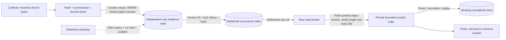

# D01 — Immutable raw evidence storage and isolation

**Status:** **Accepted with changes** — product owner, 2026-10-12 (B3 as primary class; see §8 decision record)  
**Repository version:** `v0.0.0` (no storage implementation in scope for this review)  
**Blocks:** P1 data storage contract  
**Dependencies:** D02 retention/legal hold; D05 placement/trust domains; D07 accepted data restrictions; D03 normalized/event schema

## 1. Required security outcome

Every source record must have an original byte sequence retained **without edits** for the approved retention interval, with auditable provenance, tamper detection, permission separation, and a way to make a **temporary working copy** for parsing. Processing, indexing, replay, masking, and reporting must never modify the protected original.

'Immutable' means **within a stated threat model and retention period**. Protecting against an application bug is different from protecting against an administrator, a compromised host, a malicious collector, or physical loss. No common local filesystem setting defeats a fully privileged administrator on the same machine. Hashes detect change; they do not stop deletion or supply independent proof of original source authenticity.

The existing baseline prohibits raw updates and delegates authorized expiration/deletion solely to retention. This record proposes mechanisms, not permission to delete earlier than D02 allows.

## 2. Separate four distinct records

| Concept | Identifier | What it guarantees |
| --- | --- | --- |
| **Occurrence** | `raw_ref` (opaque, unique per admitted source occurrence) | Exactly which submitted event instance is being investigated, even if another has identical bytes |
| **Payload bytes** | `blob_sha256` plus byte length and optional content key | Integrity/content identity of the received bytes; multiple occurrences may have equal content |
| **Vault object version** | `vault_object_key` + immutable `vault_version_id` (or immutable object generation) | The precise protected stored version; do not rely on a mutable “latest object” lookup |
| **Custody receipt** | `ingest_id` / audited receipt with creation time, writer ID, hash, length, lock mode and retain-until | Evidence that the ingestion system committed the specific version under a particular retention policy |

**Owner ruling (2026-10-12):** `raw_ref` stays **opaque**. It resolves to a pinned vault version plus an optional byte range — nothing more is promised by the reference itself. That resolution contract is what keeps both physical layouts in §3.1 possible: a pinned version alone for one-object-per-occurrence, a pinned segment version plus a byte range for sealed segments.

**Necessary distinction:** A digest alone is not a source-event identity; `raw_ref` must not simply equal `blob_sha256`. Two identical log lines at different positions can be two legitimate occurrences. Deduplication is not blob sharing. Physical blob deduplication must not cause premature deletion while any referenced occurrence is retained or on hold.

Idempotency proposal: use a stable source-native event position/id when available; otherwise a persisted connector-defined idempotency key that includes the source id and collection checkpoint/batch boundary and byte hash. Do not equate two matching byte strings with one event. For sources without a trustworthy stable position, explicitly document at-least-once behavior and duplicate policy. PostgreSQL nullable unique index semantics and retry races require dedicated tests; do not depend on a nullable `source_position` alone.

## 3. Storage options (raw original tier)

| Option | Mechanism | Protects against accidental modification | Resists app-host compromise/admin | Cost and retention limitations |
| --- | --- | --- | --- | --- |
| **A. Relational raw table** | PostgreSQL `bytea`/large object, append-only grants and trigger checks; original rows kept with normalized/derived | Good with tested permissions | No: privileged DB admin / DB compromise still changes rows | Simplest atomicity and backup, but weaker independent custody |
| **B1. Local protected filesystem** | Dedicated raw volume, write-once staging to final path, restrictive ACLs, optional Linux immutable flag `chattr +i`, bind/mount as read only for workers | Good against ordinary processes and mistakes | **No**: privileged host administrator can clear immutability flags or change mounts | Low complexity, useful for development/offline setups; not strong WORM |
| **B2. Local immutable snapshots + separate replicas** | ZFS/Btrfs snapshots, snapshot read only mounts, replicated snapshots to separately managed host | Stronger change recovery; immutable snapshot view for consumers | Only if separate backup domain; administrators may destroy snapshots unless controls block it | Requires snapshot schedule, replication, offhost key custody, restore tests; snapshots are not by themselves regulatory WORM |
| **B3. Independently governed WORM/object vault** | Object store/appliance with proven per-version write-once/read-many retention and legal hold; different admin identity from app | **Strongest** with verified lock semantics | Can block app-host admin deletion; resistant to vault admins only to extent the product/mode actually enforces it | Added storage service, retention lock operations, capacity, identity separation, coordinated backup; may need on-prem product for air gap |
| **B4. Cloud-managed WORM** | S3 Object Lock **compliance** mode plus versioned keys, separate cloud account permissions | Strong against accidental deletion/modification | For locked **versions**, AWS documents protection even against account root until expiry | Requires cloud authorization, internet/restricted networking, custody policy and cost; not automatically permitted in SOC environments |
| **C. Offline sealed evidence copy** | Periodic separately administered immutable/offline archive of committed raw and signed manifests | Strong secondary recovery/evidence preservation | Strong against online compromise **after a sealed copy exists** | Batch delay, media management, offline restore complexity; not a practical sole online source for live analysis |

These choices are composable. A2 deployment plus B3 vault can add B2/B4/C as a separate recovery copy if policy permits. Conversely a read-only mount of B1 on the processing container **does not** make the underlying repository immune to host root. The Linux `i` attribute is removable by privileged processes; it is only one protective layer.

**Object Lock caveat:** In S3, retention locks **object versions**, not names. A new object version or delete marker may still be created with the same key. References must pin the immutable **version ID**, and bucket policy must prohibit accidental replacement/ambiguous reads. Governance mode can be bypassed by specially privileged identities; compliance mode has stronger guarantees but also constrains early removal. S3-compatible vendors must be tested rather than assumed to implement the same enforcement.

## 3.1. Physical object layout and cost (a separate choice from storage vendor)

| Layout | Benefit | Risk | Preliminary preference |
| --- | --- | --- | --- |
| **One immutable object version per occurrence** | Direct `raw_ref` -> pinned version lookup, simple hash/retention/hold proof | Potentially very high small-object count and storage/API overhead under high EPS | Preferred for low/unknown volumes and simplest evidence model, subject to load tests |
| **Immutable sealed segments + typed manifest** | Packs many small records; index stores segment version ID, byte offset/length/hash, and ordinal; efficient transfer/backup | Delayed commit until segment sealed; corrupt segment affects many occurrences; manifest signatures and bounds must be verified | Evaluate if P3 measured ingest rate makes one-object-per-record impractical |
| **Deduplicated shared blobs** | Less storage if identical records repeat | Shared reference accounting, legal hold, retention, and record identity can become unsafe | **Rejected for v1** (owner, 2026-10-12): no physical deduplication in v1 |

Each segment must be finalized *once* and retained as a pinned immutable version before its member records are acknowledged. Its append phase is a restricted staging area, **not yet the immutable source of record**. This conflicts with the acknowledge-only-after-durable-vault-receipt rule for sources that cannot wait for a segment to seal: **owner note (2026-10-12)** — if sealed segments are adopted at P3, syslog UDP and similar fire-and-forget sources need a stated acknowledgement policy before that adoption; no segment layout is approved until that policy exists. A segment manifest must bind each occurrence ID to a byte range and checksum and be protected under the same custody rules. For high assurance, an independent append-only audit/signed receipt ledger should bind occurrence ID, source provenance, hash and vault version so a mutable relational index cannot silently redirect evidence. Signing key custody must be outside the processing host.

Capacity must not be guessed: for average events/day `E`, average original bytes per record `B`, and retention days `R`, base raw payload is approximately `E × B × R`. Add envelope/index, object metadata/API rate, WORM lock records, replicas/snapshots, backup copies, peak spool size and retention grace. D02 defines `R`; D09/P3 supply source traffic; D10 approves service targets and stress evidence. If `E` or `B` is unknown, **no capacity certification** follows from this record.

## 4. Recommended storage composition (for approval)

**Recommended:** a relational store for occurrence metadata, normalized records, quarantine, audit, and derived results; a **separately controlled WORM-capable raw vault (B3)** as the primary evidence source, plus independent immutable/offline recovery copy as required by D05/D02. If cloud is permitted and its policy requirements are met, B4 can implement that raw vault; otherwise an on-prem appliance/object service whose retention controls are demonstrably independent of GammaRay administrators is required.

This recommendation **strengthens** the previous relational + generic append-only raw tier. An ordinary directory under the same root-admin account would meet only B1's limited protection, not this design's preservation objective.

No technology brand, cloud service, OS, or storage engine has been approved. Exact product selection depends on D05 location/compliance and D02 retention. PostgreSQL is a candidate relational store, not yet adopted.

## 5. Evidence handling workflow: protected origin -> temporary copy

1. **Collect and define the boundary:** Capture exactly the bytes delivered by the source connector before parsing, trimming, newline conversion, or other transformation. Preserve whether those bytes are native producer output or a Splunk/CSV transport representation. Authenticate collectors and log provenance. The vault cannot certify the truth of upstream events.
2. **Admission:** Apply size/resource limits, allocate independent `raw_ref` and idempotency key, calculate length and SHA-256, and append to vault using a unique key plus a retention mode; verify the returned stable object version and retention metadata. Mark accepted only after the vault reports durable, protected storage (vendor contract must be verified).
3. **Index commit:** Append a relational custody receipt with `raw_ref`, byte hash, vault key/version, receipt time, lock/hold metadata, source id/type, timestamp and checkpoint. A failed index write is repaired through controlled reconciliation of vaulted, unindexed objects. No overwrite to “fix” an orphan.
4. **Read:** The worker/analyst requests a specific `raw_ref` from a broker using a role-scoped, authenticated operation. The broker performs authorization **before** retrieval, audits request/outcome, obtains only that pinned version, verifies hash/length, and returns a bounded read stream.
5. **Stage:** Prefer direct read-stream parsing. If a file is necessary, write a *copy* into a private worker scratch directory or container `tmpfs` with strict mount permissions, ownership, no host/shared mounts, bounded bytes/time, no world-readable paths, and controlled crash cleanup. Prevent the worker from receiving vault write/delete credentials. Read-only bind mounts alone are not the primary boundary. A worker may change its scratch copy; it cannot change the protected original.
6. **Normalize:** Produce schema-validated typed events and quarantine metadata, excluding free-text original messages from normalized storage under D07. The worker must not use a scratch path as a persistent source of record.
7. **Clean up:** Close file descriptors and remove ephemeral copies on success/error/restart; monitor residuals. Prefer memory-backed scratch without backing swap. Secure erasure on SSD is not guaranteed; avoid persistent scratch for restricted content unless the environment explicitly accepts its residual-data risk.
8. **Verify/replay:** Rehydrate from the vault by pinned version, check checksum, rerun pinned parser/schema versions, and compare deterministic results. Report evidence gaps, corruption, missing metadata, or quarantined records without silently substituting data.

### Mutation and deletion authority

- **Collector:** create new records, never overwrite or delete protected versions.
- **Normalizer/analyst:** read an approved `raw_ref` through the broker only, no direct vault admin access.
- **Vault administrator:** infrastructure operations only, separate from application principals. Product policy must prohibit shortening locks after admission if that is a required assurance.
- **Retention executor:** *sole software deletion path*, only after per-version lock expiry, legal-hold checks, reference checks, D02 policy, and audit. If locks block deletion, fail and alert rather than weakening locks.
- **Backups/replicas:** must preserve both raw bytes and custody metadata, version IDs or stable mapping, and hold/retention conditions. Backup operators may not be allowed to remove protected evidence by restoring an older state.

## 6. Failure, corruption, race and retention handling

| Failure | Required behavior |
| --- | --- |
| Vault PUT failed or lock status unknown | Do not acknowledge committed raw; bounded retry/spool with completeness degradation |
| Vault committed, DB insert fails | Reconcile immutable orphan to original receipt; never delete in a retry loop |
| DB receipt exists, object is missing | Raise integrity incident and quarantine downstream results; investigate restore, do not synthesize bytes |
| Hash mismatch or missing object version | Stop normalization/drill-down; audit and alert; do not use mutable latest version or silent fallback |
| Duplicate content with different source positions | Preserve two `raw_ref` occurrences, even if blob bytes are identical |
| Retention overlaps shared payload or legal hold | Do not delete content while any protected occurrence remains; avoid shared blobs unless proven safe |
| Unauthorized overwrite/delete attempted | Explicit storage rejection, recorded negative test and security alert |
| Parser crash / host restart | Remove residual restricted scratch, retain protected vault record, restart idempotently |
| Locked object expires | May only be removed by D02-controlled retention job after hold/reference/backup checks; 'immutable' is not 'forever' |

## 7. Validation required before P1 acceptance / later production qualification

Create **synthetic** negative controls for: overwrite, rename, truncate, delete, lock shortening, role confusion, directory traversal/symlink replacement, corrupt object, wrong object version, missing report, lost DB receipt, identical bytes at two positions, null source position, revoked read access, failed scratch cleanup, partial write, outage/retry, restore while legal hold is active, retention before/after expiry, and audit completeness. Simulate all operations without real SOC data.

**Architectural gate for P1:** select storage control class and trust domain and specify identifiers/write/read/retention contracts. **P7 gate:** demonstrate real vault and restore behavior in a production-like environment with negative control evidence. No local `chattr` test can substitute for a vendor WORM test or a witnessed expiry/hold exercise.

## 8. Owner decision

**Decision (product owner, 2026-10-12): Accept B3 as the primary class, with the following changes and caveats.**

- **Primary class: B3** — independently administered WORM-capable raw vault. (B4 remains the cloud implementation path for that vault where authorized, per §4; C as a secondary copy is not decided here.)
- **No physical dedup in v1.** Physical blob deduplication is not permitted in v1, per §3.1 as amended.
- **`raw_ref` stays opaque**, resolving to a pinned version plus an optional byte range (§2 as amended). One-object-per-record and sealed segments both remain possible under that contract.
- **Layout:** one-object-per-occurrence is the **P1/P2 default**. It will probably not survive Cisco syslog volumes — request and lock overhead per event adds up — so the sealed-segment decision is taken **at P3 with measured EPS**, not by assumption now. Segment adoption additionally requires the stated acknowledgement policy for UDP-type sources (§3.1 as amended).
- **Compliance-mode locks cannot be shortened.** Lock behavior is therefore tested **only in a throwaway vault with short synthetic retention**, never in a vault holding a long lock.
- **D02 timing tightened:** because a locked vault cannot be corrected after the fact, **D02 must close before any real data lands in a locked vault** — not by P7. The register and phase plan are amended accordingly.

Repository version remains `v0.0.0`. This acceptance settles the storage control class and the contracts in §2/§5; it does not select a product, and P7 still requires demonstrated vault and restore behavior (§7).

## Technical sources for verification (not product endorsements)

- AWS S3 Object Lock retention, version IDs, delete markers, governance and compliance guarantees: https://docs.aws.amazon.com/AmazonS3/latest/userguide/object-lock.html
- Linux `chattr` immutable flag and privilege requirements: https://man7.org/linux/man-pages/man1/chattr.1.html

For any on-premises S3-compatible implementation, explicitly test real object-version retention, hold enforcement, administrative bypass behavior and restore. API compatibility does not itself establish identical WORM assurance.
