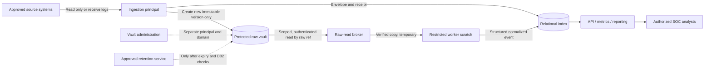

# D05 — Deployment model and complete deployment profile

**Status:** **Accepted with changes** — product owner, 2026-10-12 (A2 as target; see §6 decision record)  
**Repository version:** `v0.0.2` (Phase 0 architecture only)  
**Blocks:** P1; production environment qualification is a later P7 gate  
**Coupled decisions:** D01 raw custody, D02 retention, D07 accepted handling policy, D09 connectors, D10 operating targets

## 1. Decision to be made

Choose **where the application runs**, **where original evidence resides**, **which security principals control each component**, and **which networks data traverses**. A single-tenant choice alone is insufficient. The approved outcome must identify a deployable profile and the exact separation between a processing host and protected evidence.

`docs/ARCHITECTURE.md` and `docs/INVARIANTS.md` remain governing; this record is a proposal until approved. No production infrastructure, compliance regime, uptime target, or cloud access has been supplied; do not infer one.

## 2. Architecture options (deployment and evidence custody considered together)

| Option | Deployment shape | Advantages | Material limitations | Suitability |
| --- | --- | --- | --- | --- |
| **A1. Single application host + local raw volume** | One SOC, one host/VM; separately privileged processes; raw volume on that host | Lowest operating burden, works offline | A host administrator or host compromise can alter/delete locally protected raw data; a read-only container mount does not prevent it | Only where **accidental-change protection**, not hostile-administrator resistance, is sufficient |
| **A2. Single application deployment + independently administered raw vault** | One SOC; application services on one host/VM; original evidence written to a separately controlled protected store | Keeps app simple while separating raw custody, readers, backup, and retention; supports WORM | Second security/backup domain, vault connectivity, administration, and coordinated restore | **Preferred**, conditional on availability and accreditation of a vault |
| **B. Modular single-tenant** | Separate ingest, API, workers, database, vault deployments and identities | Strong network/failure separation; scale ingestion independently | More deployment units, service authentication, and recovery complexity | Choose when availability/throughput or security segmentation requires it |
| **C. Multi-tenant** | Shared application for several independent SOCs | Potential operational consolidation | Requires tenant-scoped policy, keys, storage, logs, exports, threat model | **Out of v1 scope** unless owner changes roadmap |

**Recommended direction: A2**, preserving the simplicity of original Option A *at the application layer* while preventing the application host from administering the raw vault. It is not equivalent to an all-on-one-host design. If an independent vault cannot be operated in the target environment, A1 with documented weaker assurances or B with dedicated storage must be an explicit owner decision, not a silent fallback.

This was the **conditional recommendation**. The owner subsequently selected A2 in §6.

## 3. Required full deployment profile

Complete the worksheet in [D05_DEPLOYMENT_PROFILE.md](D05_DEPLOYMENT_PROFILE.md). The following are essential domains:

| Domain | Required owner-supplied fact / gate | Default proposal (not approved) |
| --- | --- | --- |
| Environment / authorization | Lab, enterprise, air-gapped, regulated, or government enclave; environment authority and classification/handling regime | Unspecified. No real data until approved |
| Host and OS | Physical/VM, CPU architecture, OS image, patch cadence, hardening baseline, permissible container runtime | Supported Linux x64 VM or host (subject to owner confirmation) |
| Application packaging | Native service, systemd, containerized process, or orchestrator; update/rollback and restart ownership | One application deployment with separate service identities; container choice open |
| Network zones and flows | Source systems, collectors, API clients, vault, identity service, admin management, outbound intel feeds; direction/ports/TLS | Default-deny, explicitly allowed flows |
| Credentials / key custody | Local directory/SSO, role mapping, TLS PKI, secret vault, encryption keys, rotation, break-glass procedure | Distinct ingest, API, processor, vault-reader, vault-writer, retention, and audit principals |
| Protected evidence location | Vault placement, admin domain, storage capability and tested WORM semantics, failure access mode | Dedicated protected repository, separate from process/workspace volume |
| Database and scratch | Relational host/volume, encryption at rest, processing scratch quota and lifetime, backup/restore owner | Database separate from vault; scratch is restricted and ephemeral |
| Capacity | Sources, events/day, peak EPS, record size, retention days, disk growth, processor and vault headroom | **Unknown**: size by D01 formula and characterize in P2/P3 |
| Availability | Ingest continuity during outage, buffering, latency, RPO, RTO, planned patch windows, HA requirement | No HA claim; define D10 targets before qualification |
| Operations | Logs/metrics, integrity alarms, clock sync, upgrades, patch access, audits, backup tests, staffing | Operable by documented runbook; no manual hotfix to raw data |
| CI-to-production boundary | GitHub Actions for verification only; artifact signing, promotion and installer/air-gap import | Never place restricted/real SOC data or secrets in public runners |
| Compliance / retention | Residency, data classification, privacy, legal hold, lifecycle/deletion after lock expiry, applicable regulation | D07 policy applies; overlays remain open until owner identifies them |

A deployment cannot be called approved from only a Linux distribution and a hostname. The profile must name identity boundaries, raw evidence custody, applicable handling requirements, backup owners, and flows. D10 may provide final numeric SLO/RPO/RTO values later, but the intended operating behavior must be described now.

## 4. Trust boundaries and network flows

The intended logical flow for A2 is:

The graph is **logical**: Splunk is normally pulled by the collector, while syslog can be pushed to a listener, and Windows/macOS collection depends on D09. Every arrow represents a separately authorized trust-boundary crossing, not an approved network port or direction. Logical application boundaries do not establish host-level privilege separation unless credentials and network policy enforce them. If the target environment forbids a separate vault, the graph and its risk statement must change.

### Minimum principal matrix

| Principal | Allowed | Must not be able to do |
| --- | --- | --- |
| Collector / ingest | Read source; create a raw record in vault through write-once ingest path; append metadata receipt | Overwrite or delete a protected version; fetch arbitrary historic raw; alter normalized reports |
| Normalizer / replay | Request a specific raw ref through broker; write canonical or quarantine records | Update or delete vault records; bulk export raw; change vault retention |
| API / reporter | Query authorized normalized/derived records; request one audited raw drill-down with separate permission | Hold vault credentials, access source systems, write raw, bulk stream the vault |
| Raw-read broker | Verify requester and raw ref, check integrity, audit, return bounded data | Update/delete evidence, enumerate indiscriminately, grant access from an untrusted UI flag |
| Retention operator | Check hold and expiry, delete eligible expired objects under D02, audit | Modify retained bytes, bypass holds, delete without evidence |
| Vault administrator | Operate storage and key infrastructure through a separately governed identity | Act as an analyst by default; retroactively weaken existing locks |
| CI runner | Build and test with synthetic fixtures | Reach production sources, raw vault, operational secrets, or private logs |

## 5. Availability, offline environments, and failure semantics

- **Disconnected/air-gapped network:** use locally deployable storage capable of independently verified retention locks, or explicitly downgrade the assurance to local snapshot and offline-copy controls. Cloud S3 must not be assumed acceptable.
- **Vault inaccessible:** ingestion must not report committed data; buffer only in a bounded, encrypted, controlled queue according to an approved policy, mark data completeness degraded, and resume idempotently. A disconnected buffer is **not** a committed immutable record.
- **Relational index unavailable after vault write:** preserve or recover the vaulted object by reconciliation; never overwrite it to force consistency. Commit visible ingestion only after durable vault receipt and index reconciliation.
- **Lost application host:** recover the application and index without changing vaulted originals. RPO/RTO remain D10 choices, not claims.
- **Compromised application administrator:** with A2, may compromise processing and temporary copies, but should not possess credentials to shorten/delete locked raw versions. Protection depends on actual vault settings and separated identities.
- **Compromised collector before vault commit:** immutability cannot authenticate a tampered source; collection authentication and provenance still matter.

## 6. Approval inputs and owner decision

Before accepting D05, record in the deployment profile: (1) authorized environment and data handling regime; (2) where app and vault can reside; (3) network segments and allowed flows; (4) chosen package/process model and OS; (5) administration and key custody separation; (6) outage behavior and recovery ownership; (7) backup and retention custody; (8) source collection and external egress restrictions.

**Owner decision (product owner, 2026-10-12): Accept A2 as the target architecture, with changes.** Recorded terms:

- **A2 is the target architecture.** The raw store sits behind the `src/raw/` interface.
- **B1 (local protected volume) is permitted for development and lab use only.** It is not a production topology and not a silent fallback: §2 already forbids silently falling back to A1-grade assurance, and B1 carries that same weaker assurance (accidental-change protection only).
- **Production claims require B3 or B4 evidence at P7.** No production or hostile-administrator claim may be made from a B1 deployment.
- Deciding question (owner): whether anyone must be unable to alter evidence even with admin on the GammaRay host. If yes, the separate vault is required; if the real threat were only bugs and accidents, A1-grade protection would be enough. A2-as-target is the recorded answer; B1's dev/lab carve-out does not change it.
- **Worksheet gating reduced:** DP-01, DP-02, DP-03, DP-07, DP-09 and DP-12 are enough to derive the P1 interfaces. Capacity, HA, backup sequencing and CI promotion items are deferred to P3 or P7 — deferred, not waived, and they still gate those phases.

Repository version is `v0.0.2` (Phase 0 correction, not P1 acceptance). P1 interface work is **not yet unblocked**: DP-01, DP-02, DP-07, DP-09 and DP-12 still require owner values. Later worksheet items remain gated at their deferred phases.
